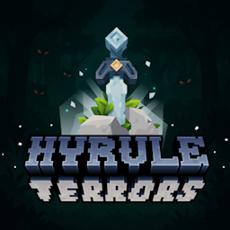

<p align="center">
  
</p>

<h1 align="center">Hyrule Terrors</h1>

<p align="center">
  <b>Breath of the Wild inspired monsters, gear and adventure for Minecraft 1.21.1</b><br>
  Fabric &amp; NeoForge
</p>

<p align="center">
  <a href="https://www.curseforge.com/projects/1216095"></a>
  
  
  <a href="https://discord.pixeldreamstudios.net"></a>
</p>

---

Hyrule Terrors brings the wilds of Hyrule into your world. Bokoblin camps dot the plains, Chuchus take on the
elements around them, Keese swarm the caves, and the legendary Master Sword waits in the deep dark for a worthy hero.

## Monsters

| Monster | Where | What to know |
|---|---|---|
| **Bokoblin** | Plains, forests, Bokoblin forts | Carries crude weapons. Horn-blowers alert the whole camp; wear a **Bokoblin Head** to walk among them unnoticed. |
| **Lizalfos** | Mountains, forests | Fast and tough. Sometimes wields a **Lizal Spear**, and scrambles away when badly hurt. |
| **Blue Chuchu** | Flower fields, forests | Takes on its surroundings: **fire turns it Red, freezing turns it White, lightning turns it Yellow.** |
| **Red Chuchu** | Deserts, badlands, savannas | Bursts into flames when struck. |
| **Yellow Chuchu** | Forests, savannas | Electrically charged. Hitting it in melee while charged shocks *you*, so use arrows or wait for it to discharge. |
| **White Chuchu** | Snowy and icy biomes | Its touch freezes. It bursts into a frost cloud when killed, and fire melts it back to Blue. |
| **Keese** | Caves across the Overworld | Swooping cave bats. |
| **Fire / Ice / Electric Keese** | Nether & badlands / snowy biomes / deserts & savannas | Every bite burns, freezes, or shocks, and they burst with their element on death. |

## Weapons & Shields

- **Master Sword**: awakens near sculk, bosses, evil mobs, or in the Nether/End, dealing bonus damage to evil foes. **At full health, right-click to fire a Sword Beam.** Sleeps in Ancient City chests.
- **Hylian Shield**: enormous durability, fireproof while held, and when raised in a thunderstorm it calls lightning down on nearby monsters.
- **Boulder Breaker**: a two-handed Goron crusher that also mines stone like a pickaxe.
- **Knight's Claymore**, **Silver Longsword**, **Lizal Spear** (right-click lunge), **Lizalfos Horn Dagger**, and the not-entirely-dead **Bokoblin Arm**.

## Armor Sets

Every set has a full-set bonus.

| Set | Bonus |
|---|---|
| Hero (Cap, Tunic, Trousers, Boots) | Strength while at full health |
| Zora | Water Breathing and faster swimming |
| Barbarian | Strength |
| Knight | Resistance, plus extra Knight's Claymore damage |
| Evil Spirit | Strength II and Night Vision |

## Elixirs & Gear

Brew elixirs at a crafting table from a **glass bottle + Chuchu jelly + a monster part**:

| Elixir | Effect |
|---|---|
| Hearty | Instant health and extra hearts |
| Mighty | Strength |
| Tough | Resistance |
| Hasty | Speed |
| Sneaky | Invisibility |
| Fireproof | Fire Resistance |
| Electro | **Shock Resistance**: immune to lightning and electric attacks |
| Chilly | **Frost Resistance**: immune to freezing |

- **Paraglider**: hold right-click while falling to glide, with no fall damage.
- **Rupees**: Green (1), Blue (5) and Red (20). Monsters drop them and they convert at a crafting table. Wandering Traders buy monster parts for Rupees and sell elixirs, the Paraglider, the Hylian Shield and the Master Sword.

## Installation

1. Install [Fabric](https://fabricmc.net/) or [NeoForge](https://neoforged.net/) for Minecraft **1.21.1**.
2. Install the required dependencies:
   - [Architectury API](https://www.curseforge.com/minecraft/mc-mods/architectury-api)
   - [AzureLib](https://www.curseforge.com/minecraft/mc-mods/azurelib) 3.2.8+
   - [Cloth Config](https://www.curseforge.com/minecraft/mc-mods/cloth-config)
   - [Fabric API](https://www.curseforge.com/minecraft/mc-mods/fabric-api) (Fabric only)
   - [Mod Menu](https://www.curseforge.com/minecraft/mc-mods/modmenu) (optional, Fabric, for the in-game config screen)
3. Drop the Hyrule Terrors jar for your loader into your `mods` folder.

Hyrule Terrors must be installed on **both the client and the server**.

## Configuration

Mob health, damage, movement speed and spawn weights, plus every Master Sword option and legendary chest loot, can be
changed in `config/hyrule_terrors.json5` or in-game (Mod Menu on Fabric, the Mods screen on NeoForge).

Biome spawns are data-driven through biome tags (`data/hyrule_terrors/tags/worldgen/biome/*_spawn_in.json`), and the
Master Sword's "evil" list is the `hyrule_terrors:evil_mobs` entity tag, so modpacks can tweak both with a datapack.

## Compatibility

- **Better Combat**: weapon attribute files are included, so Hyrule weapons get proper swing animations and reach.

## Building from source

```bash
git clone https://github.com/Bandit-bytes/Hyrule_terrors.git
cd Hyrule_terrors
./gradlew build
```

Jars are written to `fabric/build/libs/` and `neoforge/build/libs/`. Requires JDK 21.

## Reporting issues

Found a bug or have an idea? [Open an issue](https://github.com/Bandit-bytes/Hyrule_terrors/issues/new/choose) and
please include your loader, mod version and a log.

## License

Copyright © 2025-2026 Bandit-Bytes. **All Rights Reserved.** See [LICENSE](LICENSE).

Hyrule Terrors is an unofficial fan project. *The Legend of Zelda* and related names are trademarks of Nintendo; this
mod is not affiliated with or endorsed by Nintendo.
